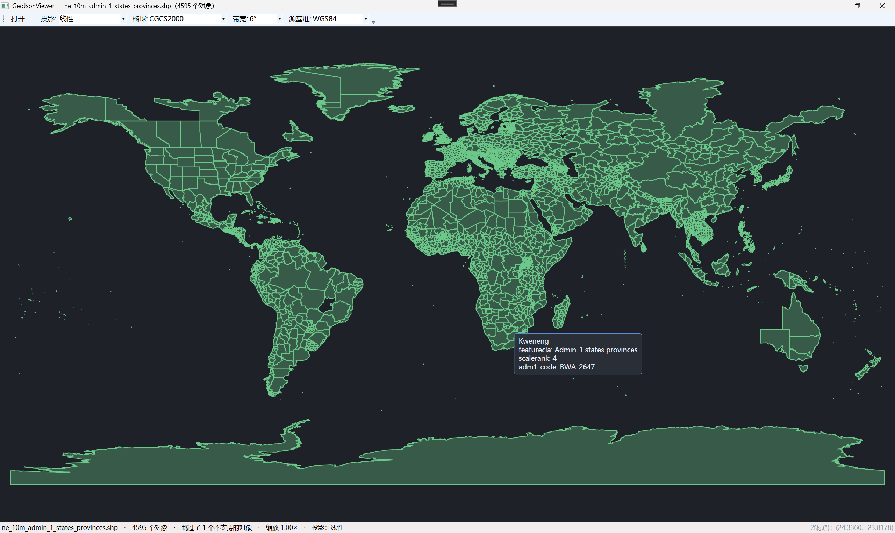

# GeoJsonViewer · 迷你 GeoJSON 查看器

一个 Windows 桌面小程序（C# + WPF）：打开 `.geojson` 文件，把点、线、面画到画布上，
支持滚轮缩放、左键拖拽平移、鼠标悬停查看属性。

它是一个练手项目：存在的目的是把「投影与坐标映射」这条流水线亲手走通一遍。
它不打算替代任何地图软件，也不追求性能。

## 它长什么样



## 功能

- **打开**：工具栏 `[打开…]`，读 `.geojson`（`FeatureCollection`）。
- **自动适配**：打开后自动 fit —— 全部对象可见、居中、四周留 20 px 边距。
- **画法**：点是圆点、线是折线、面是半透明填充。
- **投影**：右上角下拉框切换 `线性` / `Web 墨卡托`，切换后立即按新投影重新 fit。
- **缩放**：滚轮缩放，范围 `0.2× ~ 20×`，**以鼠标位置为锚点**（鼠标下的那个点保持不动）。
- **平移**：按住左键拖拽，拖多少走多少。
- **悬停**：鼠标靠近某个对象时弹出提示框，显示它的名字（`name`，没有就 `title`，再没有就「未命名的点/线/面」）
  以及最多 3 个属性；提示框贴不到右边/下边时会自动翻到另一侧。
- **状态栏**：`文件名　·　N 个对象[　·　跳过了 M 个不支持的对象]　·　缩放 x.xx×　·　投影：线性/Web 墨卡托`。
- **出错不崩**：文件不存在、JSON 语法错、空 `FeatureCollection`，都在绘图区中央显示一行中文提示，
  例如「这个文件里没有可显示的对象」「JSON 格式不对（第 9 行第 3 个字符附近）：这个文件不是合法、完整的 JSON。」

## 快速开始

需要 **.NET 10 SDK**（项目目标框架是 `net10.0-windows`，只在 Windows 上跑）。

```powershell
dotnet run                                   # 启动窗口
pwsh -File .\build.ps1 selftest              # 不开窗口，跑一遍自检
```

自检（`GeoJsonViewer.exe --selftest`）会把解析、两种投影、fit、缩放锚点、拉窗口、命中测试
以及几个边角用例文件都过一遍，打印实测数值，退出码 `0` 表示全部通过。

## 支持的 GeoJSON

| `geometry.type` | 支持情况 |
|---|---|
| `Point` / `LineString` / `Polygon` | 支持 |
| `MultiPoint` / `MultiLineString` / `MultiPolygon` | 支持：1 个要素展开成多个对象，属性共用一份（飞地之间不会被连出一条线） |
| `GeometryCollection` | 不支持，跳过并计数 |
| 其他未知类型 | 跳过并计数 |

宽容策略——不因为一个坏元素拒绝整个文件：

- `coordinates` 里多余的第三个数（高程）忽略；坏点（不是数字、NaN、无穷、不够两个数）丢掉该点，其余照画；
- `properties` 的值不管是数字、布尔还是 `null`，统一转成字符串；嵌套对象/数组保留原始 JSON 文本；
- 单个要素缺 `geometry`、缺 `coordinates`、`type` 不在白名单 → 计一次「跳过」，其余对象照常显示；
- 只有整个文件都用不了时才报错（文件不存在、JSON 语法坏、根不是 `FeatureCollection`）。

## 示例数据

`Samples/` 里的 `.geojson` 会跟随程序一起复制到输出目录，也是「打开…」对话框的默认位置：

| 文件 | 内容 |
|---|---|
| `beijing-shanghai-guangzhou.geojson` | 手工测试数据：北京、上海、广州 + 一条线 + 一个三角形 |
| `贵州省.geojson` | 真实数据（阿里 DataV）：9 个市州、19 个多边形、5590 个点，全部是 `MultiPolygon` |
| `empty.geojson` | 空 `FeatureCollection`：应显示「这个文件里没有可显示的对象」 |
| `broken.geojson` | 坏 JSON：应显示带行列位置的中文提示 |
| `skipped.geojson` | 各种不支持/坏数据的样本：应读成 5 个对象、跳过了 7 个 |
| `one-point.geojson` | 只有一个点：点应落在视图中心，尺寸正常，不会被 fit 放大成占满屏幕的巨点 |

## 已知限制

- 只支持**三种**投影（线性、Web 墨卡托、GK）
  国内数据（GCJ-02 火星坐标）直接画会有几百米量级的偏移。
- 面**只画外环**：`Polygon` 里有洞（内环）时，洞会被一起填实。
- 不处理 `GeometryCollection`。
- 没有空间索引：渲染和命中测试都遍历全部对象，几万个点还行，百万级需要网格 / 四叉树。
- 没有瓦片、没有网络、没有图层管理、没有属性编辑，也不读 shapefile。
